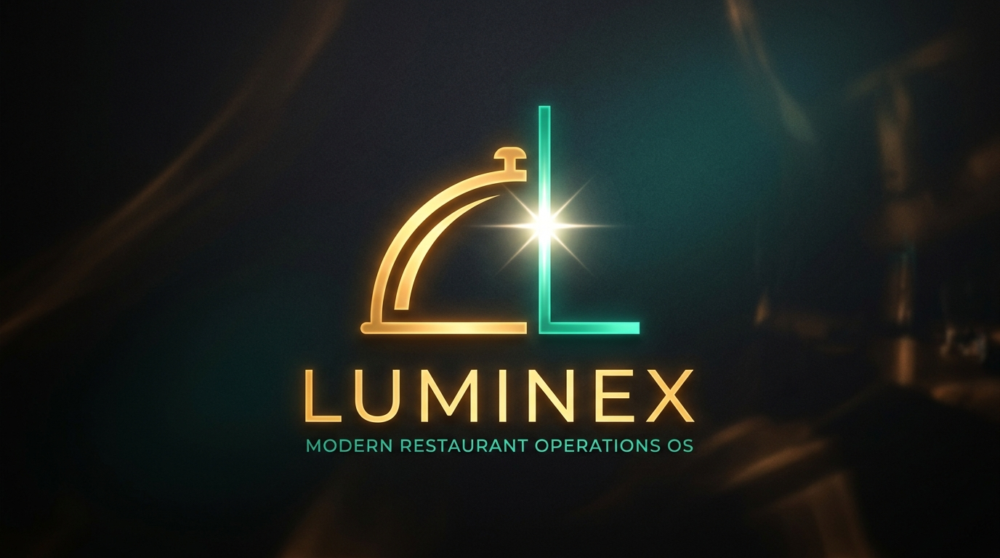

# Luminex Brand Identity & Logo System

  

## 1. Triết lý thiết kế (Brand Philosophy)

**Luminex** ra đời để giải quyết bài toán cốt lõi lớn nhất trong vận hành nhà hàng:
**Sự đứt gãy và thiếu minh bạch ("Hộp đen") giữa Front-of-House (FOH) và Back-of-House (BOH)**.

- **FOH (Mặt trước / Sảnh phục vụ):** Nơi của hiếu khách (Hospitality), nụ cười, tốc độ xoay vòng bàn, sự hài lòng của thực khách.
- **BOH (Mặt sau / Bếp & Kho):** Nơi của kỷ luật, định lượng chuẩn, tồn kho chuẩn xác, kiểm soát hao hụt và đơn giá mua hàng.
- **Pain Point:** FOH quá tải không rõ tình trạng bàn, khách chờ bức xúc; BOH thiếu nguyên liệu không báo kịp, thất thoát không rõ nguyên nhân.

Biểu tượng Luminex lấy cảm hứng từ chữ cái **L** tinh giản, kết hợp giữa hai hình tượng:
1. **Nét dọc (BOH Pillar - Digital Emerald / Cyan-Teal):** Trụ cột nền tảng vững chắc của kho, bếp và master data.
2. **Nét ngang (FOH Crescent - Warm Amber Gold):** Đường cong uyển chuyển của chiếc nắp đĩa phục vụ (Service Cloche / Dome) và bàn ăn hiếu khách.
3. **Tâm điểm ánh sáng (The Luminary Spark / Điểm tựa đồng bộ):** Ngôi sao 4 cánh phát sáng rực rỡ tại điểm giao thoa giữa FOH và BOH — tượng trưng cho khoảnh khắc dữ liệu thời gian thực được kết nối liền mạch, xóa tan bóng tối vận hành.

---

## 2. Hệ thống màu sắc thương hiệu (Color Palette)

| Vai trò | Màu sắc | Mã Hex | Ý nghĩa |
|---|---|---|---|
| **BOH Precision** | Digital Teal | `#2DD4BF` / `#0F766E` | Công nghệ chuẩn xác, dữ liệu minh bạch, kiểm soát kho & định lượng |
| **FOH Hospitality** | Warm Amber | `#F59E0B` / `#FEF08A` | Lòng hiếu khách, sự ấm áp của ẩm thực, sự chào đón tinh tế |
| **Luminary Spark** | Pure White Light | `#FFFFFF` | Ánh sáng soi rọi, sự đồng bộ tức thì, một nguồn sự thật duy nhất |
| **Obsidian Base** | Deep Slate | `#081016` / `#0B171D` | Bối cảnh sang trọng, chiều sâu cao cấp của không gian ẩm thực hiện đại |

---

## 3. Quy cách sử dụng (Usage Guidelines)

- **Vector Favicon:** `frontend/public/favicon.svg` (Hiển thị sắc nét trên browser tab, bookmark)
- **App Icon Mark:** `frontend/public/luminex-mark.svg` (Ứng dụng mobile, PWA, touch icon)
- **Full Horizontal Logo:** `frontend/public/luminex-logo.svg` (Sidebar, Navbar, Reports, In ấn hóa đơn)
- **React Component:** `<LuminexLogo variant="mark" | "horizontal" | "lockup" size={...} />` trong `frontend/src/components/LuminexLogo.tsx`
